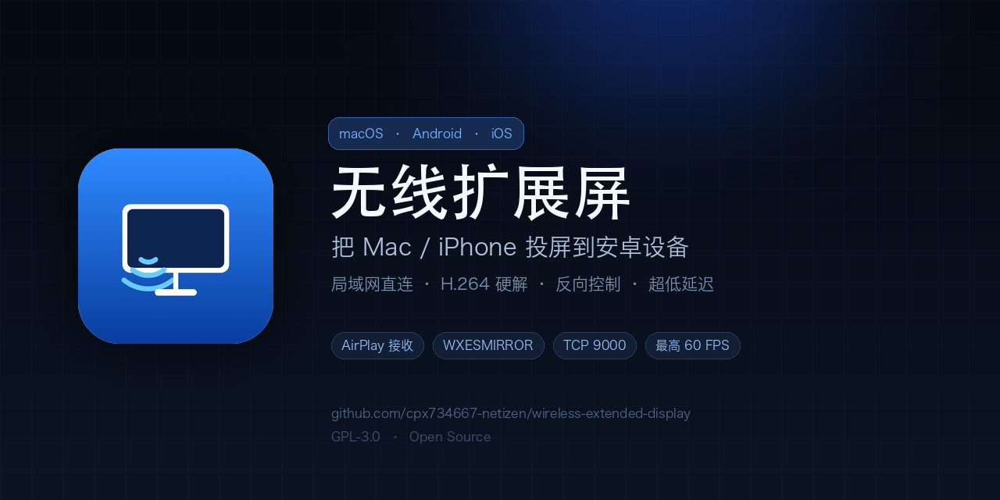
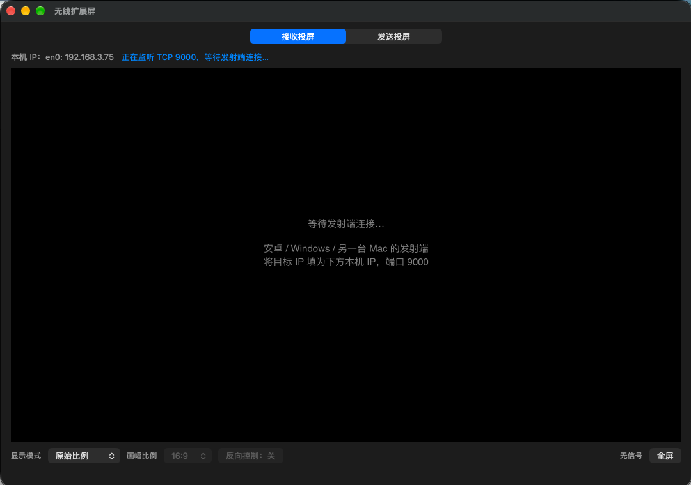
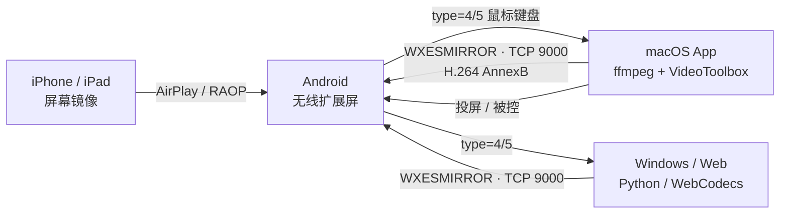

# 无线扩展屏

**把 Mac / iPhone 投屏到安卓设备，局域网、超低延迟、可反向控制。**

[](https://github.com/cpx734667-netizen/wireless-extended-display/releases/latest)
[](LICENSE)
[](#下载)
[](#下载)
[](mac/)
[](android/)



> 也叫「无线拓展屏」。一个安卓 App + 一个 Mac App，把家里闲置的平板/手机/电视盒子
> 变成 Mac 的第二块屏，或者把 iPhone 画面直接投到安卓上。全部局域网直连，不经过云端。

---

## 它能做什么

| 场景 | 发送端 | 接收端 | 说明 |
|---|---|---|---|
| iPhone / iPad 投屏 | 系统「屏幕镜像」 | 安卓 App | AirPlay / RAOP，免装 iPhone App |
| Mac 投屏 / 扩展屏 | macOS App | 安卓 App | 自有 `WXESMIRROR` 协议，TCP 9000 |
| Windows 投屏 | Python 脚本 | 安卓 App | 同一协议，`gdigrab` + libx264 |
| 安卓投到 Mac | 安卓 App（发布 APK 内置） | macOS App | 安卓录屏 + H.264；源码含 `MirrorSender` |
| 浏览器看画面 | 任意 WXES 发送端 | 网页桥 | WebCodecs 解码 |
| 反向控制 | 接收端 | 发送端 | 鼠标/键盘/触摸，跨 Mac / Windows / Android |
| 被控制 | 发送端 | 接收端 | 让对方控制本机鼠标键盘 |

### 亮点

- **两条链路**：iPhone 走 AirPlay（系统原生），Mac/Windows 走自有无损低延迟协议；
- **超低延迟**：5 GHz Wi-Fi 下 30fps 端到端约 **60–120 ms**；
- **反向控制**：安卓无障碍 / macOS CGEvent / Windows 低级钩子，无需 root；
- **真·扩展屏**：Mac 可把任意一块屏（含虚拟显示器）投到安卓，不止镜像主屏；
- **不经过云端**：没有账号、没有服务器、没有流量费；
- **源码全开**：macOS（Swift）、Android（Kotlin）、Windows（Python）、网页桥（Python/JS）。

---

## 下载

| 平台 | 文件 | 大小 | 链接 |
|---|---|---:|---|
| Android 7.0+ | `Wireless-Extended-Display-v1.6.apk` | ~42 MB | [**直接下载 APK**](https://github.com/cpx734667-netizen/wireless-extended-display/releases/download/v1.6/Wireless-Extended-Display-v1.6.apk) |
| macOS 13+（arm64） | `Wireless-Extended-Display-1.1.0-macOS.dmg` | ~19 MB | [**直接下载 DMG**](https://github.com/cpx734667-netizen/wireless-extended-display/releases/download/v1.6/Wireless-Extended-Display-1.1.0-macOS.dmg) |
| Windows | `wxes-windows-sender.zip` | ~10 KB | [下载 Windows 发送端](https://github.com/cpx734667-netizen/wireless-extended-display/releases/download/v1.6/wxes-windows-sender.zip) |

所有版本：[GitHub Releases](https://github.com/cpx734667-netizen/wireless-extended-display/releases/latest) ·
校验和：`SHA256SUMS.txt`（同 Release）。

> **国内镜像（作者早期分享，v1.0.0）**：
> [123 云盘](https://1858521005.share.123pan.cn/123pan/x1kbvd-azsQ3)
> （可能需要登录；建议优先用 GitHub Releases 的 v1.6）
>
> APK 是作者签名，和自行构建的包签名不同，覆盖安装前请先卸载旧版。
> APK 安装后系统信息可能显示 `1.3.7`（原构建的 versionName），功能对应本 Release v1.6。
> macOS 包是 ad-hoc 签名、未公证，首次打开需右键 → 打开；当前 DMG 为 Apple Silicon（arm64），Intel 请从源码构建。

---

## 5 分钟上手

### 1. 装安卓端

1. 下载上面的 APK，安装；
2. 打开 App，允许通知；
3. 记住主页 / 「扩展屏」页显示的本机 IP（例如 `192.168.3.75`）。

### 2. iPhone / iPad → 安卓

1. iPhone 和安卓连**同一个 Wi-Fi**；
2. iPhone 控制中心 → **屏幕镜像**；
3. 选择 **无线扩展屏**；
4. 如果开了 PIN，在安卓端输入 PIN。

无需在 iPhone 上安装任何 App。DRM 视频（Apple TV、Netflix 等）会黑屏，这是 AirPlay 限制。

### 3. Mac → 安卓

1. 下载 DMG，拖进「应用程序」，右键 → **打开**；
2. 第一次发送时允许 **屏幕录制**，然后完全退出 App 重开；
3. Mac App → **发送投屏**；
4. 目标 IP 填安卓的 IP，端口 `9000`；
5. 分辨率 `1280×720`，帧率 `30`，码率 `6000`；
6. 点 **开始投屏**。

安卓端点开「扩展屏」接收页，看到「正在监听 TCP 9000」即可。

### 4. 反向控制（可选）

**Mac 控制安卓：**

1. 安卓：设置 → 无障碍 → **无线扩展屏** → 开启；
2. Mac：接收页 / 发送页 → **反向控制：开**；
3. 首次会请求「辅助功能」，授权后重启 App；
4. 在安卓画面上点击/拖动，Mac 鼠标键盘即可操作安卓。

**安卓控制 Mac：**

1. Mac：发送投屏 → 开始后打开 **被控制**；
2. 授权辅助功能，重启 App；
3. 安卓端在画面上点击/拖动。

更细的步骤、权限说明、Windows/网页端用法见
[**docs/usage.md**](docs/usage.md)。

---

## 界面

macOS 接收端：



- 自动监听 9000，显示本机 IP；
- 原始比例 / 拉伸 / 自定义画幅；
- 实时 fps、源分辨率、全屏；
- 一键反向控制。

安卓端提供 AirPlay 接收主页 + 独立的「扩展屏」接收页（SurfaceView 硬解 + 触摸反控）。

---

## 架构



- **视频下行**：H.264 AnnexB，`baseline`、无 B 帧、1 秒 GOP；
- **控制上行**：同一 TCP 连接上的 `type=4`（鼠标）/ `type=5`（键盘）；
- **坐标**：0–1000 相对值，发送端按自己屏幕尺寸换算；
- **心跳**：5 秒；接收端 20 秒无数据自动断开。

协议细节、包格式、键码表、最小实现：
[**docs/protocol.md**](docs/protocol.md) ·
架构与设计取舍：[**docs/architecture.md**](docs/architecture.md)。

---

## 性能建议

| 目标 | 分辨率 | 帧率 | 码率 |
|---|---|---:|---:|
| 低延迟优先 | 1280×720 | 15 | 3000–4000 kbps |
| 平衡（推荐） | 1280×720 | 30 | 5000–8000 kbps |
| 文字/代码 | 1920×1080 | 30 | 8000–12000 kbps |
| 高刷游戏 | 1920×1080 | 60 | 12000–20000 kbps |

- 优先 **5 GHz Wi-Fi**；2.4 GHz 容易卡顿；
- 关闭安卓省电模式、智能分辨率；
- 路由器关闭「AP 隔离 / 客户端隔离」；
- 不要跨公网直接映射 9000（协议无加密，见下）。

经验参考：M 系列 Mac + 5 GHz + 旗舰安卓，30fps/6Mbps 约 **60–120 ms**；
AirPlay 链路通常再多 50–150 ms。

---

## 从源码构建

```bash
git clone https://github.com/cpx734667-netizen/wireless-extended-display.git
cd wireless-extended-display
```

### macOS

```bash
cd mac
./build.sh
open "build/无线扩展屏.app"
```

要求：macOS 13+、Xcode Command Line Tools、`brew install ffmpeg`。
构建脚本会把 ffmpeg 及 27 个 dylib 一起打包进 App，产物约 38 MB。
详见 [mac/README.md](mac/README.md)。

### Android

```bash
cd android
git submodule update --init --recursive   # 或 ./setup-submodules.sh
./gradlew assembleDebug
```

要求：Android Studio / SDK、JDK 17、NDK `27.0.12077973`、约 10 GB 磁盘。
首次会编译 FFmpeg/OpenSSL，20–40 分钟。详见 [android/README.md](android/README.md)。

### Windows / 网页

```bash
# Windows 发送端
cd windows
pip install pyautogui pillow imageio-ffmpeg
python sender_win.py

# 网页桥
cd web
pip install websockets
python bridge.py   # 打开 http://<本机IP>:8080/
```

---

## 目录

```
wireless-extended-display/
├── mac/                    macOS App（Swift + AppKit + VideoToolbox）
│   ├── src/                Receiver / Sender / Decoder / Ctrl / UI
│   ├── scripts/            ffmpeg 打包、图标、Python 发送端
│   └── build.sh
├── android/                Android App（Kotlin + Compose + UxPlay）
│   ├── app/.../mirror/     WXES 接收 / 发送 / 无障碍反控
│   ├── app/.../renderer/   MediaCodec 视频管线（上游）
│   └── setup-submodules.sh
├── windows/                Windows 发送端（Python + tkinter）
├── web/                    网页桥（Python + WebCodecs）
├── tools/                  协议测试：假接收端
├── docs/                   协议、架构、使用指南
└── LICENSE                 GPL-3.0
```

---

## 已知限制

- **无加密/认证**：同一局域网内任何人都能连 9000 并发送控制消息，仅建议可信网络使用；
- **WXES 只传视频**：Mac/Windows 链路暂无音频回传；iPhone AirPlay 链路包含音频；
- **DRM 内容**：AirPlay 受保护视频会黑屏；
- **Android 构建重**：需要 NDK + FFmpeg/OpenSSL 源码编译；
- **macOS 未公证**：ad-hoc 签名，首次打开需右键；每次重新构建可能重置权限；
- **反向控制有限**：复杂输入法、自绘输入框、UAC 提权窗口可能不生效；
- **没有 iOS 发送端**：iPhone 走系统 AirPlay，不需要额外 App。

---

## 参与贡献

- 协议/端实现问题：开 Issue，带上设备型号、系统版本、日志；
- Android 日志：`adb logcat -s MirrorReceiver VideoRenderer`；
- macOS 日志：`/tmp/wxes_debug.log`；
- PR 请保持一个 PR 一件事，并说明测试环境。

如果这个项目帮你省下了一块便携屏的钱，点个 ⭐ 就是最好的支持。

---

## 致谢

- [jqssun/android-airplay-server](https://github.com/jqssun/android-airplay-server) —
  Android AirPlay 接收器（GPL-3.0）
- [FDH2/UxPlay](https://github.com/FDH2/UxPlay) — AirPlay/RAOP 协议实现
- [FFmpeg](https://ffmpeg.org/) — 采集、编码、封装
- Apple VideoToolbox / AVFoundation、Android MediaCodec / AccessibilityService

## License

[GPL-3.0](LICENSE) © 2026 cpx734667-netizen

本项目包含/链接 GPL-3.0 的上游 AirPlay 接收器与 FFmpeg 构建，整体按 GPL-3.0 分发。
第三方组件与版权声明见 [NOTICE](NOTICE)。
